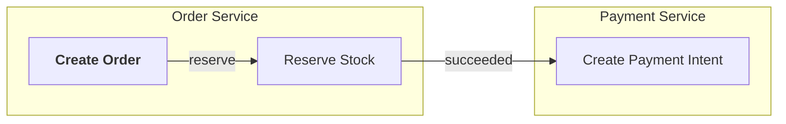

# 工作流规则 · AI 助手执行细则

本文件定义单次任务的执行阶段、门禁、会话结束协议与熵增整理。心法见 [[core_mindset]]，硬规则与征求清单见 `00__AGENT_START_HERE.md`。

---

## 一、任务执行阶段

| 阶段 | 动作 | 产出 |
|---|---|---|
| 1. 上下文加载 | 按 `00__AGENT_START_HERE.md` 的三步启动 | 内部认知，简报 |
| 2. 任务澄清 | 确认目标、范围与验收标准；有歧义则提问 | 一句话任务定义 |
| 3. 设计先行 | 读相关意图块与设计文档；需要变更则先改设计 | 更新后的规格 / ADR 草案 / 图 |
| 4. 编码 | 先写测试或同步更新测试，再实现 | 代码与测试 |
| 5. 自动验证 | 运行三绿门禁 | 三绿状态 |
| 6. 会话结束 | 执行会话结束协议，输出变更简报 | 更新后的 `20__` 文件与简报 |

阶段 3 中涉及征求清单的动作（见 `00__AGENT_START_HERE.md`），在此阶段停下，等待人类裁决。

---

## 二、三绿门禁（任务完成的硬标准）

任何代码变更结束前，以下三项必须全部通过：

| 门禁 | 含义 | 失败时的处理 |
|---|---|---|
| 类型 | 类型检查器零错误（tsc / mypy / cargo check） | 自行修复，不许用 `any`、`# type: ignore` 糊弄 |
| 测试 | 相关测试全部通过（含新增与回归） | 自行修复；若测试本身有问题，先确认再改 |
| Lint | linter / formatter 零告警（eslint / ruff / clippy） | 自行修复；禁用行级压制 |

**执行节奏**：
- 阶段 4 写完代码后立即进入阶段 5 跑三绿
- 任一不通过，自我修复，不留给人类
- 三轮内修不好，停下来诊断根因，避免陷入"小修小补循环"；必要时写入 `open_questions_for_human.md`

**禁止压制告警**：
- 禁用 `any`、`# type: ignore`、`@ts-ignore`、`eslint-disable`
- 确需例外时，必须：
  1. 在意图块或该行上方写 `why` 注释说明理由
  2. 追加到 `open_questions_for_human.md`，等待人类复核

**变更简报必须包含三绿状态**（格式见 `00__AGENT_START_HERE.md`）。

---

## 三、ADR 规则

- 所有 ADR 动作（新建、状态变更、添加"被取代"关系）均需人类拍板，无例外
- 已 Accepted 的 ADR，内容字段永不修改（背景、决策、理由、后果、触发重新评估条件）
- 决策要变：新建 ADR，经人类确认后，旧 ADR 的状态改为 Superseded 并指向新 ADR
- 状态字段允许的转移：
  - `Proposed → Accepted`（人类拍板后）
  - `Proposed → Rejected`
  - `Accepted → Superseded by [[ADR__NNNN-<新结论>]]`
  - `Accepted → Deprecated`

**发现 ADR 冲突时**，LLM 不自行标注，而是：
1. 在整理报告中列出冲突对
2. 追加到 `open_questions_for_human.md`，格式：
   ```
   Q-xxx: ADR 冲突需要裁决
   - [[ADR__NNNN-<旧结论>]] 与 [[ADR__MMMM-<新结论>]] 的决策不兼容
   - 冲突点：...
   - 建议处理：将 ADR__NNNN 标为 Superseded，指向 ADR__MMMM
   - 等待人类确认
   ```
3. 人类回复后，才执行状态字段的修改

**批量确认**：熵增整理时，ADR 相关变更汇总为一份"建议变更清单"，一次性交人类批量确认，不逐条打断。

---

## 四、悬空链接检查

在会话结束协议中执行，流程如下：

1. 用 `rg -oNI "\[\[[^]]+\]\]" <本次改动涉及的路径>` 收集所有 `[[]]` 引用
2. 对每个引用 `X`，确认是否存在名为 `X.md`（或同名其他扩展名）的文件，搜索范围为 `10__`、`20__`、`30__`、`40__` 目录
3. 以下情形不计为悬空，直接忽略：
   - 含占位符字符的引用：`<`、`>`、`xxx`、`NNNN`、`MMMM`、`...`
   - 不是文件名的匹配（如本节示例中的正则）
   - 位于 `_TEMPLATE__` 开头的模板文件中的引用
4. 列出所有其余未命中的 `X`
5. 修复：创建目标文件，或修正引用名
6. 修复后仍有未命中的，追加到 `open_questions_for_human.md`

**纪律**：输出非空就必须在本次会话内修复或登记，不留给下次。

`50__HUMAN_SOURCE_DO_NOT_EDIT/` 不在检查范围内，该目录内容由人类管理。

---

## 五、会话结束协议

会话结束前依次执行：

1. `ls 20__EDIT_BEFORE_SESSION_END/`，逐个检查并更新：
   - `project_state_now.md`：更新系统现状，保留最近 5 条变更记录
   - `task_board.md`：更新 In Progress（不超过 2 项）、清空 Done
   - `open_questions_for_human.md`：新增本次登记的 Q-xxx，已解决的标注
2. 执行悬空链接检查（见第四节）
3. 若本次新增或修改了设计文件，确认其 `[[]]` 引用双向一致
4. 输出变更简报（格式见 `00__AGENT_START_HERE.md`）

---

## 六、熵增整理

**触发条件**：每 10 次会话，或每周，或人类说"整理一下"。

**执行项**：
1. `open_questions_for_human.md`：已解决项归档
2. `project_state_now.md`：压缩过时内容
3. `task_board.md`：清空 Done
4. ADR 冲突检查：按第三节处理，结果汇总为批量确认清单
5. 代码与规格漂移扫描：`40__CODING_IS_CHEAP/src/` 与 `10__` 至 `30__` 中的规格是否一致
6. 结构性设计漂移扫描：`30__DECISION_AND_DESIGN_ARE_EXPENSIVE/50__STRUCTURAL_DESIGNS/` 中的 SEQUENCE、STATE 是否仍反映实际行为（MODULE 为目标图，不参与漂移扫描，但需检查"当前偏离"条目是否仍成立）
7. 悬空 `[[]]` 全量检测（含代码意图块）
8. `domain_terminology_glossary.md` 术语漂移清理
9. `ls` 友好度检查：单目录文件数超过 50 时，提议拆分，由人类裁决
10. 扫描 `40__CODING_IS_CHEAP/src/` 下以下划线开头的目录（如 `_scratch/`、`_experiment-*`）：对每个目录询问人类"转正 / 归档 / 删除"
11. 输出整理报告，包含所有待人类批量确认的事项

---

## 七、Mermaid 图表规范

- **适用范围**：所有 Mermaid 图表均须遵守本节规则。
- **必画范围**：结构性设计（`SEQUENCE__`、`STATE__`、`DATAFLOW__`、`MODULE__`）必须使用 Mermaid 绘制。
- **代码块**：使用 ` ```mermaid ` 代码块封装，不使用其他语法标记。
- **节点样式**：节点内的样式使用 HTML 标签（如 `<b>`、`<br/>`），不使用 Mermaid 的 `style` 与 `classDef` 语句。
- **文本引号**：所有描述性文本使用英文双引号 `""` 包裹，包括节点标签、连线标签、参与方别名与消息内容。
- **多子图组织**：先在各子图内定义节点，后在全局定义连接。不在子图定义之前引用其中的节点。

示例（节点标签与连线标签均使用英文双引号包裹）：


