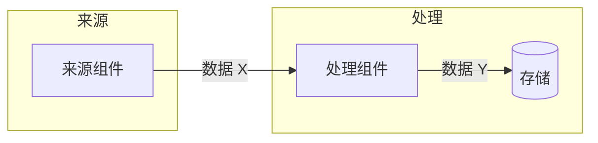

# DATAFLOW: 在此填写业务数据流名（文件名同步改为 DATAFLOW__<名称>.md）

> 场景：在此描述数据在哪些组件间流动，以及为什么
> 关联功能：[[FEATURE__xxx]]
> 注意：修改本图须人类拍板（见 [[workflow_rules_for_ai]]）
>
> Mermaid 规范（详见 [[workflow_rules_for_ai]] 第七节）：代码块用 ` ```mermaid ` 封装；节点样式用 HTML 标签；描述性文本用英文双引号包裹；先在子图内定义节点，后在全局定义连接。

---



---

## 数据契约

- 键 / 字段格式：…
- 超时与过期：…
