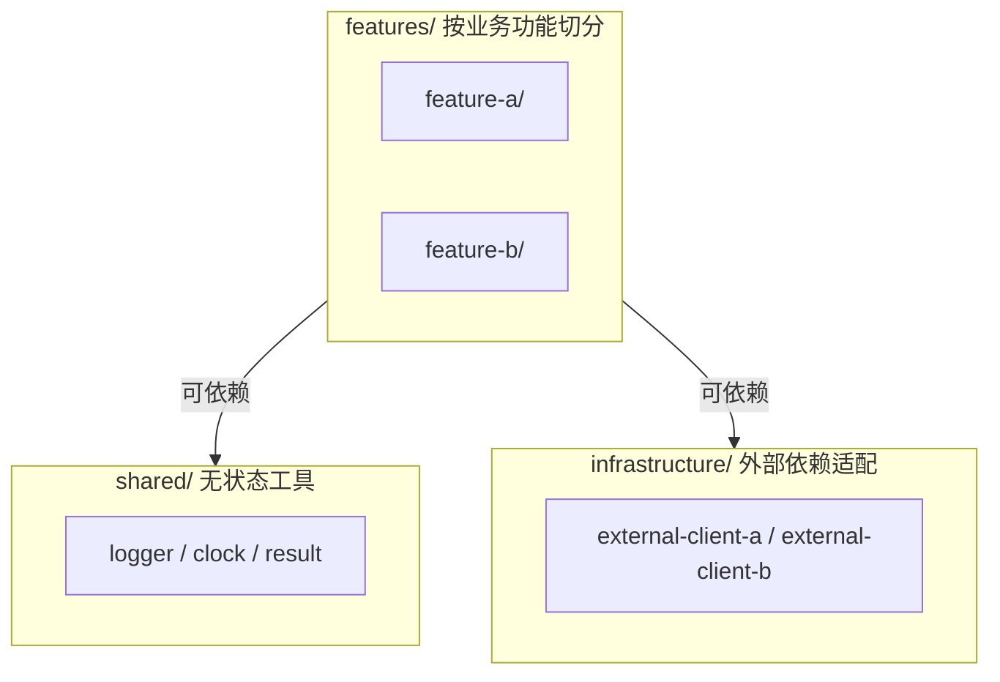

# MODULE: 在此填写目标结构名（文件名同步改为 MODULE__<名称>.md）

> 本图表达目标结构（规范性），不是当前结构。当前结构由代码反映。
> 关联 ADR：[[ADR__NNNN-xxx]]（如有）
> 注意：修改本图须人类拍板（见 [[workflow_rules_for_ai]]）
>
> Mermaid 规范（详见 [[workflow_rules_for_ai]] 第七节）：代码块用 ` ```mermaid ` 封装；节点样式用 HTML 标签；描述性文本用英文双引号包裹；先在子图内定义节点，后在全局定义连接。

---

## 目标结构



---

## 依赖规则

- `features/*` 之间不直接依赖，通过 `shared/` 或事件
- `shared/` 不依赖 `features/` 与 `infrastructure/`
- `infrastructure/` 不依赖 `features/`

---

## 当前偏离

记录目标结构与代码现状的差异。每条须登记到 [[open_questions_for_human]]。

TODO：暂无。
