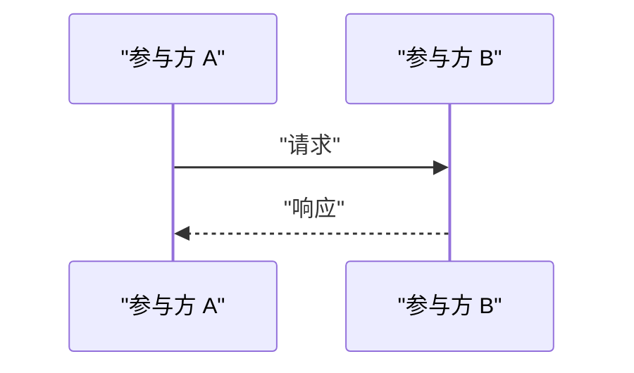

# SEQUENCE: 在此填写场景名（文件名同步改为 SEQUENCE__<场景>.md）

> 场景：在此描述触发条件与结果
> 关联功能：[[FEATURE__xxx]]
> 关联 ADR：[[ADR__NNNN-xxx]]（如有）
> 注意：修改本图须人类拍板（见 [[workflow_rules_for_ai]]）
>
> Mermaid 规范（详见 [[workflow_rules_for_ai]] 第七节）：代码块用 ` ```mermaid ` 封装；节点样式用 HTML 标签；描述性文本用英文双引号包裹；先在子图内定义节点，后在全局定义连接。

---



---

## 关键约束

- 事务边界：…
- 幂等保证：…
- 超时与重试：…

## 异常路径

- 场景 X 失败时：…（如有独立时序，链接到另一份 SEQUENCE 文件）
