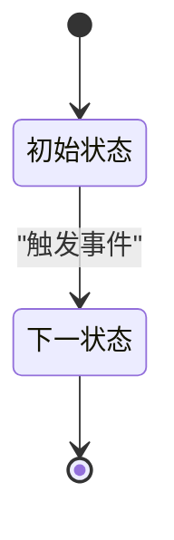

# STATE: 在此填写实体名（文件名同步改为 STATE__<实体>-lifecycle.md）

> 实体：在此填写
> 关联功能：[[FEATURE__xxx]]
> 注意：修改本图须人类拍板（见 [[workflow_rules_for_ai]]）
>
> Mermaid 规范（详见 [[workflow_rules_for_ai]] 第七节）：代码块用 ` ```mermaid ` 封装；节点样式用 HTML 标签；描述性文本用英文双引号包裹；先在子图内定义节点，后在全局定义连接。

---



---

## 转移约束

- 状态 A → B：触发条件，副作用（如释放库存）

## 不允许的转移

- 状态 X → 状态 Y：原因
