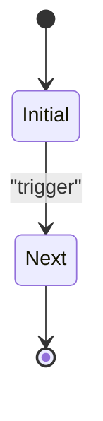

# STATE__entity-lifecycle

Optional. State diagrams are for entities with an important lifecycle or a risk of illegal transitions.

Key transition conditions or forbidden transitions (if needed): …
